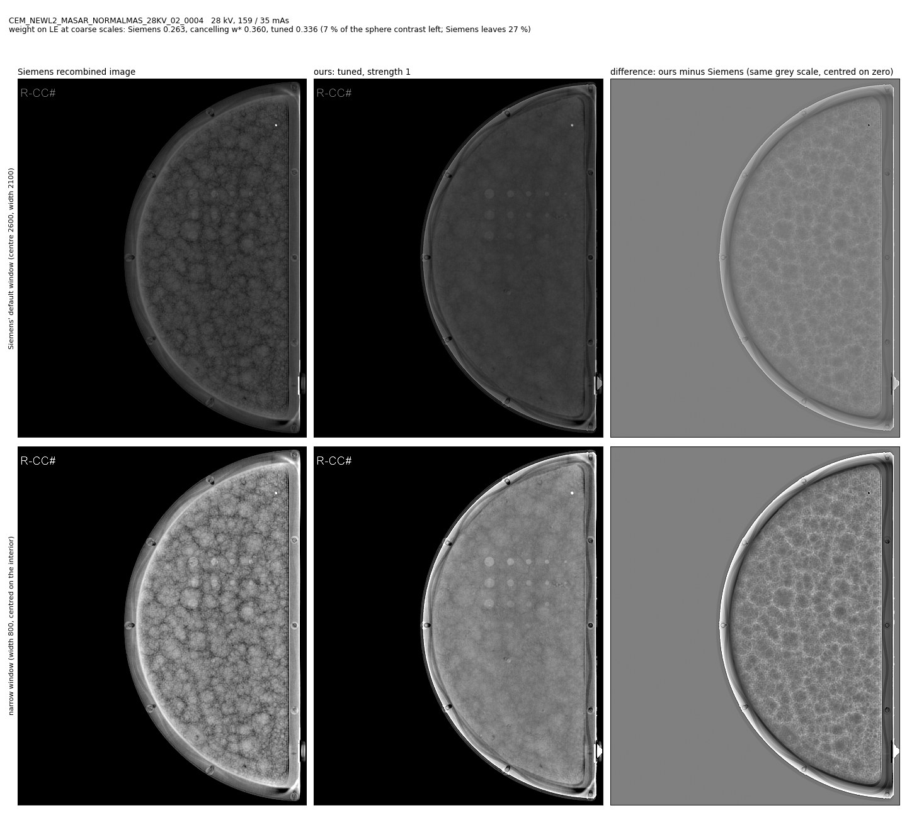
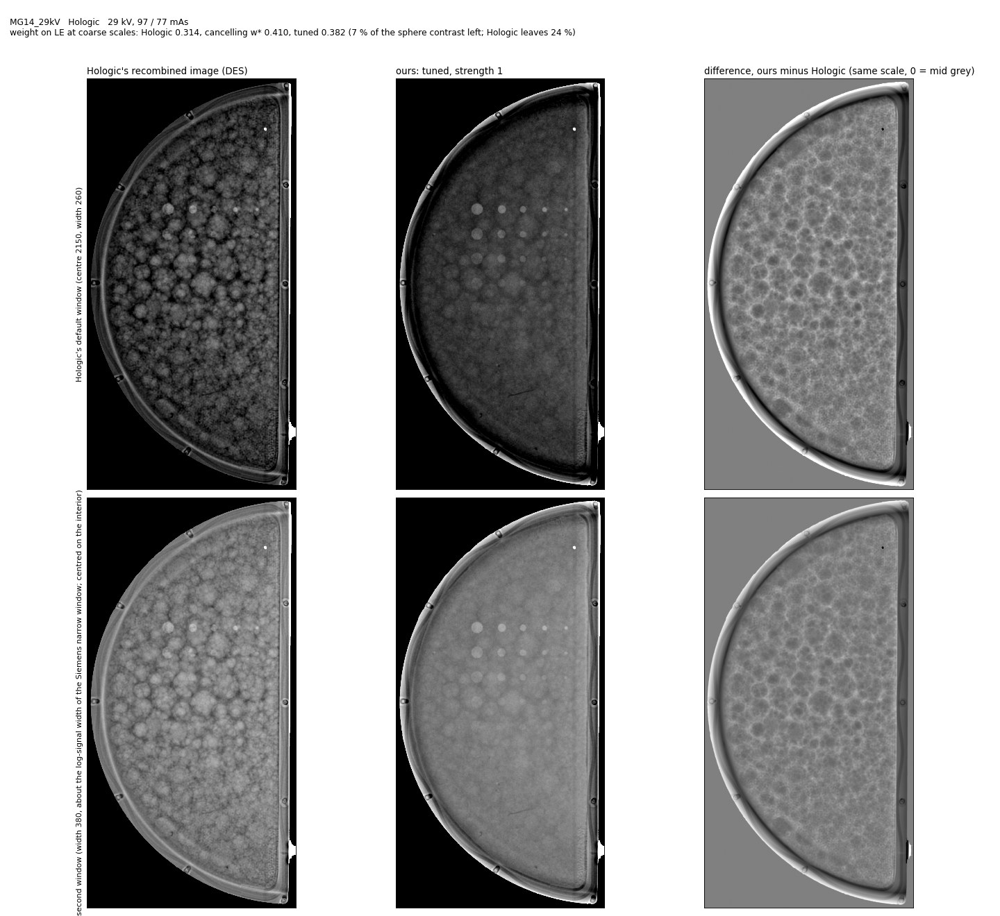
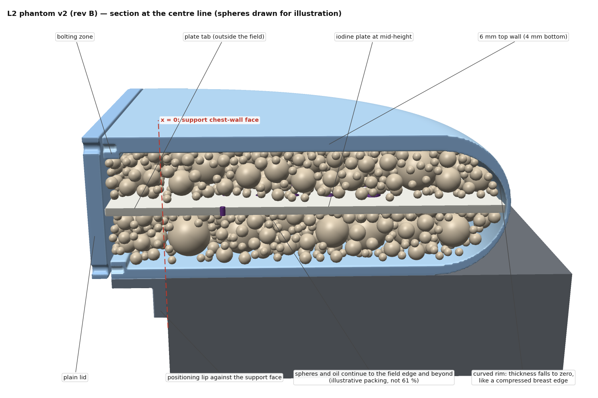

# L2 phantom for contrast-enhanced mammography

This repository holds three pieces of my work on the L2 phantom, a breast phantom with iodine discs that I use to
measure iodine detectability in contrast-enhanced mammography (CEM):

1. **A tuned recombination** of the dual-energy images, so that the phantom background looks as strong as breast
   tissue does in a clinical CEM image, not three to four times stronger.
2. **A redesigned container (L2 v2)**, made to give the phantom a breast-like edge and to remove the fixed structures
   that the current container shows in the image.
3. **A Monte Carlo model (GATE 10)** of the Siemens MAMMOMAT Revelation with the current L2 and with the redesign.

The reader study software that I use with these images is not part of this repository, because it is not freely
available. The images themselves and the patient data are not included either (see "What is not here").

## The problem

In CEM the system takes a low-energy (LE) and a high-energy (HE) image and subtracts them on a log scale with a
weight: HE minus w times LE. The weight is chosen so that glandular and adipose tissue cancel and the iodine remains.

The L2 phantom imitates breast texture with PMMA spheres of six sizes (1.6 to 15.9 mm, equal volume each) in paraffin
oil. This pair of materials needs a different weight to cancel. On the Siemens Revelation the phantom background
cancels at about 0.36 at 28 kV, while the system uses 0.255. On the Hologic Selenia Dimensions it is 0.41 against 0.31.
Both systems therefore leave about a quarter of the sphere contrast in the recombined image. In real breasts the same
weight leaves very little. The phantom background is far stronger than breast structure, and an iodine detection test
on it is harder than it would be in a patient.

## 1. Tuned recombination

Folder: `tuned_recombination/`

The tuned image is still a weighted subtraction of the raw HE and LE images, with my weight; I take the gain, the noise filtering and the border processing from the manufacturer’s image. I keep the manufacturer's image as it is, with its edges, walls,
mask and grey scale, and change only the weight on the background:

    R_tuned = R - IFFT{ c(f) FFT(LE log image) },   c(f) = alpha(f) [ w_t(f) - w_eff(f) ]

For every image on its own, and in 13 spatial-frequency bands:

1. I measure the manufacturer's gain `alpha(f)` and effective weight `w_eff(f)` from its own recombined image, by
   regressing it on the two log images in regions inside the phantom.
2. I measure the weight `w*(f)` that cancels the sphere background, from the same regions.
3. Regions with iodine discs, bubbles or the marker are found and left out automatically.
4. I choose a tuned weight `w_t = w* (1 - rho)`. The share `rho` of the sphere contrast that stays in is set so that
   the remaining structure at coarse scales (0.06 to 0.3 cycles/mm) has the power that Siemens' recombination leaves
   in real breasts. I measured that once on nine views of two patients; the script holds only the aggregated numbers.
   The share fades to zero at 1 cycle/mm, where breasts show no structure.
5. I apply the correction to the whole image and measure the weight again in the result as a check.

A strength option scales the left-in share: 0 is full cancellation, 1 is the breast level, 2 is double.

**How I checked it.** If the model of the manufacturer's image is right, recombining the raw LE and HE images at the
measured weight must reproduce that image. It does in the interior of the phantom: on Siemens, 97 to 99.6 % of the
image power up to 1 cycle/mm and a pixel correlation of 0.94 to 0.97; on Hologic, 99.9 % and 0.92 to 0.94. It does not
in the outer 15 mm, where both manufacturers apply their own border processing. That is why I correct their image
instead of replacing it.

**Results.** On 112 Siemens exposures (28, 30 and 32 kV, three dose levels) the tuned images keep 5.4 to 7.8 % of the
sphere contrast (one exposure 3.5 %), against 22 to 29 % under Siemens' own weight. On 15 Hologic exposures they keep 6.3 to 6.9 %, against
23 to 26 %. The weight measured in each tuned image agrees with the designed one within 0.0014.

*Siemens' recombined image (left), the tuned image (middle) and their difference, for one 28 kV exposure.*

*The same for one Hologic exposure.*

**Scripts**

| File | What it does |
|---|---|
| `l2_tuned_recombination.py` | The method for Siemens TiCEM images. This is the version I used for my reader study. |
| `l2_tuned_recombination_multisystem.py` | The same method for Siemens and Hologic. In my test on a Siemens exposure it gave the same pixels as the first script. |
| `hologic_noise_shape.py` | Measures the noise shape of the Hologic detector in the open field (I had no published MTF for it). |
| `compare_systems.py` | One table of both systems: acquisition data from the headers and the results of the method. |
| `method_document/` | The full description with every equation, the checks and the literature (`L2_tuned_recombination_method.pdf`). |
| `results/system_comparison.xlsx` | The comparison table of the 112 Siemens and 15 Hologic exposures. |

**Running it**

    python3 l2_tuned_recombination.py 28kV --siemens-weighting
    python3 l2_tuned_recombination_multisystem.py hologic --out hologic --system-weighting
    python3 l2_tuned_recombination.py 28kV --strengths 1.0 0.5 2.0

The scripts look for the DICOM files below the folders given. Each exposure needs its raw LE and HE images and the
manufacturer's recombined image. The output for every image is a tuned DICOM file, a comparison picture, the curves
per frequency band, and one Excel file with all numbers.

**Assumptions to keep in mind.** The breast target comes from two patients on one Siemens unit. For Hologic I had no
raw breast images, so I used the Siemens target unchanged; this is an assumption, not a measurement. The method needs
the manufacturer's recombined image and the raw image pair. The method document lists all limits.

## 2. The L2 v2 container

Folder: `L2_container_v2/`

The current L2 container has a vertical PMMA wall along its curved side and a straight wall on the chest-wall side
that lies inside the image. The vertical wall projects as about 53 mm of PMMA over its outer few millimetres, and the
subtracted image shows a bright band inside the curved edge. My GATE model reproduces that band and shows that most
of it comes from scatter.

In the redesign I changed the geometry, not the idea of spheres in a liquid:

- **A rounded rim**, like the periphery of a compressed breast. The filling thickness falls smoothly to zero over the
  outer 27 mm. The rim wall is 1.5 mm at the equator, the PMMA equivalent of breast skin.
- **An extension of 20 mm beyond the chest-wall edge.** The spheres and the liquid continue into it, so the image
  shows "tissue" up to the chest wall. The lid, the screws, the gasket and the plate supports sit in the extension,
  outside the field. The only fixed structure left in the image is the rounded rim.
- **A longer iodine plate** (2 mm PMMA) at mid-height, held in slots in the extension.
- **A removable positioning bracket** that hooks against the chest-wall face of the breast support, so the phantom
  sits in the same place every time.

`MATERIALS.md` compares background materials. Besides PMMA spheres in paraffin oil, I looked at glandular-equivalent
spheres (PA12 with calcium carbonate) in an adipose-equivalent oil.

**Status.** The design is finished apart from a few open points (listed in `DESIGN_NOTES.md`, for example the
clearance of the overhang on the system and the expansion of the oil). The STL files were checked for printing: closed
meshes, the designed wall thicknesses, slots and lugs. The phantom has not been built yet, so I cannot yet show that it removes the edge band in
the system's own image. The STL files and the drawing sheet (`drawings/L2v2_drawing.pdf`) show the current version. The
STEP files and renders show the version before the last changes (equal 5 / 5 mm top and bottom walls, 2 mm plate, lugs
at the slot ends).

**Files.** `l2v2_geom.py` holds the parameters and the checks; `l2v2_step.py` makes the STEP and STL files (it needs
CadQuery); `l2v2_render.py` and `l2v2_drawing.py` make the pictures. `DESIGN_NOTES.md` explains every choice and the
open points.

## 3. GATE 10 model of the Revelation

Folder: `gate_model/`

The model simulates one CEM exposure pair on the Revelation: source, air, compression paddle, phantom and breast
support in GATE 10, then the anti-scatter grid and the selenium detector per photon, plus an exact noise-free primary
image. It can use the current L2 or the L2 v2 container, with several background materials.

I compared it with a measured L2 exposure, analysed in exactly the same way. Inside the phantom the cancelling weight,
its frequency dependence and the LE level agree within 3 %. The bright band inside the curved edge is reproduced
(simulated +0.080 at about 9 mm from the edge, measured +0.073 at about 7 mm); its height is 16 to 18 % too high.

**Status.** I ran it with opengate 10.1.1 on a Linux workstation. The parts that need no GATE (materials, grid,
projector, normalisation, sphere packing) pass `selftest.py` in this folder layout. The L2 v2 meshes and sphere packing
in `gate_model/phantom/` were made for the 22 October version of the design (3 mm plate, 6 / 4 mm walls). To simulate
the final design, regenerate them with `phantom_meshes.py` and `sphere_packing.py` and point `V2_PARAMS` in
`config.py` to `L2_container_v2/params.json`. `gate_model/README.md` describes
every part, the first-run checks and the open questions.

    python3 selftest.py
    PHANTOM=L2 BACKGROUND=PMMA_paraffin ./run_all.sh

The comparison scripts (`compare_measured.py`, `pipeline_compare.py`, `compare_0035.py`) also need my measured images
and analysis scripts, which are not in this repository.

## What is not here

- **The images.** The phantom DICOM files are too large for GitHub.
- **Patient data.** The breast target rests on nine clinical views that I was approved to use. The code holds only
  aggregated numbers (median and range per frequency band). The per-view spectra are not included as data; the method
  document shows them only as unlabelled curves in Figure 2. `make_figures.py` needs the measured images and these
  per-view spectra, so it cannot run from this repository alone.
- **The reader study software**, which is not freely available.

## Requirements

Python 3 with numpy, scipy, pydicom, matplotlib, pandas, openpyxl and pillow (`requirements.txt`). The container files
need CadQuery. The GATE model needs opengate 10.1.1, SpekPy, uproot and scikit-image; plotly only for the 3D previews.

## Literature

The equations rest on published work on dual-energy imaging, spectral analysis and anatomical noise. The method
document cites 56 references at the places where they apply and lists which steps are new.
